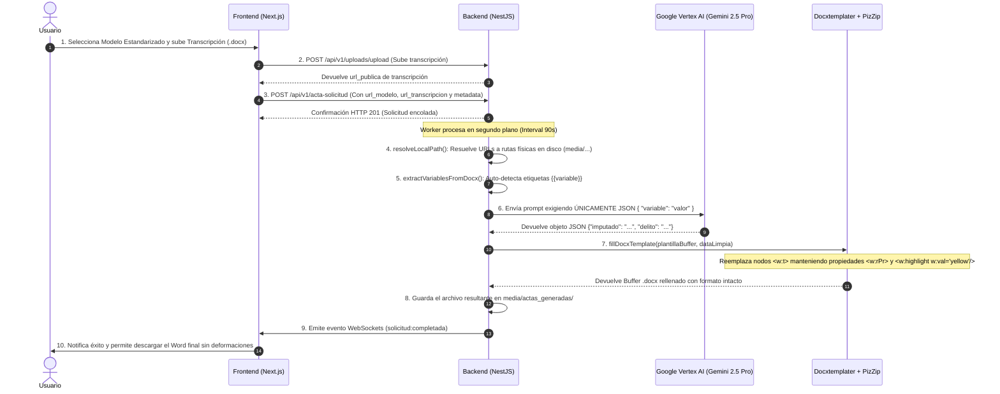

# Documentación Técnica: Sistema de Generación de Actas por Modelo (.docx + Gemini + Docxtemplater)

Este documento detalla los cambios, correcciones y optimizaciones implementados tanto en el **Frontend** como en el **Backend** para lograr la descarga directa de archivos Word y el rellenado perfecto de plantillas manteniendo **el 100% del formato original (fuentes, tamaños, márgenes, tablas, logos y resaltados en color amarillo)**.

---

## 1. Resumen de Problemas Resueltos

| Problema Original | Causa Raíz | Solución Implementada |
| :--- | :--- | :--- |
| **Descarga fallida de Word** | `downloadFileDirectly` buscaba `'token'` en lugar de `'access_token'` y apuntaba a `/api/upload/...` en el puerto del front en lugar de la API del backend. | Se corrigió el token (`access_token`), la URL base (`NEXT_PUBLIC_API_URL`) y se agregó resolución de rutas relativas con fallback. |
| **Cambio de tipo de letra y tamaño** | El backend le pedía a Gemini redactar un acta entera en texto/Markdown y luego creaba un Word nuevo desde cero con estilos por defecto. | Se cambió el flujo para que Gemini solo devuelva **JSON** con los datos, y `Docxtemplater` inyecte esos datos directamente en la plantilla `.docx` original. |
| **Movimiento de párrafos / Deformación** | `Docxtemplater` tenía `linebreaks: true`, convirtiendo los `\n` de Gemini en nuevos párrafos XML `<w:p>`. Además, no tenía delimitadores `{{ }}` configurados. | Se configuró `delimiters: { start: '{{', end: '}}' }`, `linebreaks: false`, `paragraphLoop: false` y se sanitizaron las variables con `dataLimpia`. |
| **Pérdida del resaltado amarillo** | Al recrear el Word desde cero, se descartaban los atributos XML de resaltado `<w:highlight w:val="yellow"/>`. | Al modificar únicamente los nodos `<w:t>` del XML original con `Docxtemplater`, el atributo de resaltado amarillo de la plantilla permanece intacto. |

---

## 2. Cambios Realizados en el Frontend (`d:\iactas\front`)

### A. [`uploadApi.ts`](file:///d:/iactas/front/src/store/api/uploadApi.ts)
- **`downloadFileDirectly`**:
  - Obtiene la URL base desde `process.env.NEXT_PUBLIC_API_URL` (puerto 3009).
  - Utiliza la clave de autenticación correcta: `localStorage.getItem('access_token')`.
  - Intenta secuencialmente el endpoint `/upload/download-file`, `/uploads/download-file` y el acceso directo a recursos estáticos en el backend (`/media/...`).

### B. [`modelo-detail-dialog.tsx`](file:///d:/iactas/front/src/components/plantillas/modelo-detail-dialog.tsx)
- **`handleDownloadDocx`**:
  - Convertido a función asíncrona con gestión de `toast.loading`, `toast.success` y `toast.error`.
  - Si la descarga directa por API falla, ejecuta un fallback inteligente calculando el origen del backend para abrir la plantilla en una pestaña nueva con `window.open`.

### C. [`plantilla-form-dialog.tsx`](file:///d:/iactas/front/src/components/plantillas/plantilla-form-dialog.tsx)
- Escaneo de etiquetas `{{variable}}` en cliente utilizando `pizzip`.
- Generación automática de `jsonSchema` a partir de las variables detectadas en la plantilla subida.

---

## 3. Cambios Realizados en el Backend (`d:\iactas\back`)

### A. [`upload.service.ts`](file:///d:/iactas/back/src/upload/upload.service.ts)
- **`resolveLocalPath(urlOrPath: string)`**:
  - Convierte cualquier URL HTTP/HTTPS (ej: `http://localhost:3009/uploads/2026/09/04/modelo.docx`) o ruta relativa (`/uploads/...`, `media/...`) a la ruta física real en disco (`D:\iactas\back\media\...`).
- **`extractVariablesFromDocx(buffer: Buffer)`**:
  - Lee la estructura XML del documento Word (`word/document.xml`) y extrae automáticamente todas las etiquetas con formato `{{variable}}`.
- **`fillDocxTemplate(plantillaPathOrBuffer, data)`**:
  - Implementa `Docxtemplater` sobre el buffer de la plantilla original con la siguiente configuración estricta:
    ```typescript
    const doc = new Docxtemplater(zip, {
      delimiters: { start: '{{', end: '}}' },
      paragraphLoop: false,
      linebreaks: false,
      nullGetter: () => '',
    });
    ```
  - **Sanitización `dataLimpia`**: Reemplaza caracteres de salto de línea (`\r\n`, `\n`, `\r`, `\t`) por espacios simples antes de renderizar para evitar la creación de párrafos adicionales en Word.

### B. [`acta-procesamiento.service.ts`](file:///d:/iactas/back/src/acta-solicitud/acta-procesamiento.service.ts)
- **`procesarSolicitud(solicitudId: number)`**:
  - **Modo Plantilla Inteligente**: Se activa automáticamente cuando se detecta un modelo `.docx` con variables o `json_schema`.
  - **Prompt Estructurado a Gemini**: En lugar de pedirle redactar el documento, se le exige responder **ÚNICAMENTE** con un objeto JSON válido conteniendo las claves de las variables.
  - **Inyección directa**: El JSON retornado por Gemini se pasa a `uploadService.fillDocxTemplate`, produciendo un buffer `.docx` resultante que conserva el 100% de la tipografía, tamaños, márgenes y **resaltado amarillo**.

---

## 4. Diagrama del Flujo de Ejecución



---

## 5. Guía de Buenas Prácticas para Crear Plantillas Word (.docx)

1. **Escritura limpia de variables**: Escribe la variable completa `{{imputado}}` de un solo trazo en Microsoft Word para evitar que el XML interno fragmente la palabra en múltiples nodos (`<w:r>`).
2. **Resaltado en amarillo**: Para que un dato inyectado aparezca resaltado en amarillo en el acta descargada, selecciona la etiqueta `{{variable}}` en tu plantilla Word y aplícale el **Color de resaltado del texto -> Amarillo** desde la cinta de opciones de Word.
3. **Mantenimiento de formato**: Aplica a la etiqueta `{{variable}}` la misma fuente (ej: Arial), tamaño (ej: 11pt) y estilo (ej: Negrita) con el que deseas que aparezca el valor extraído.
